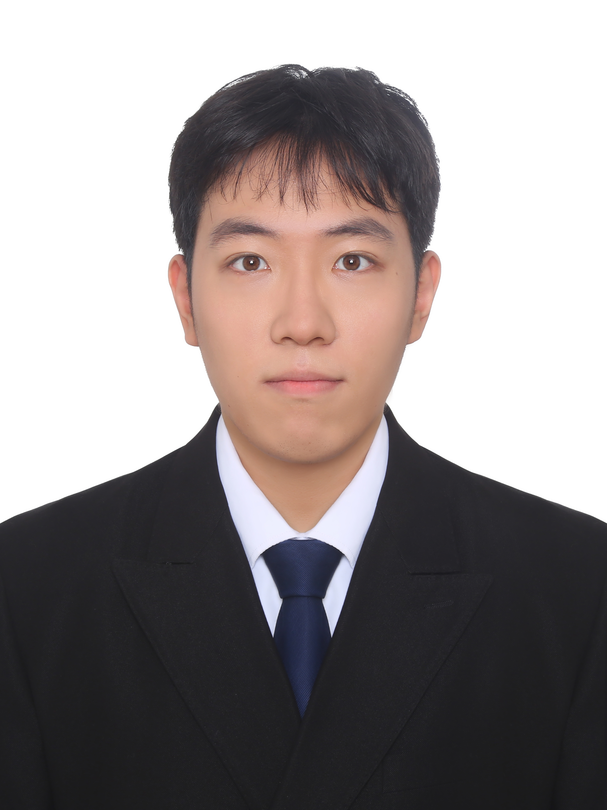
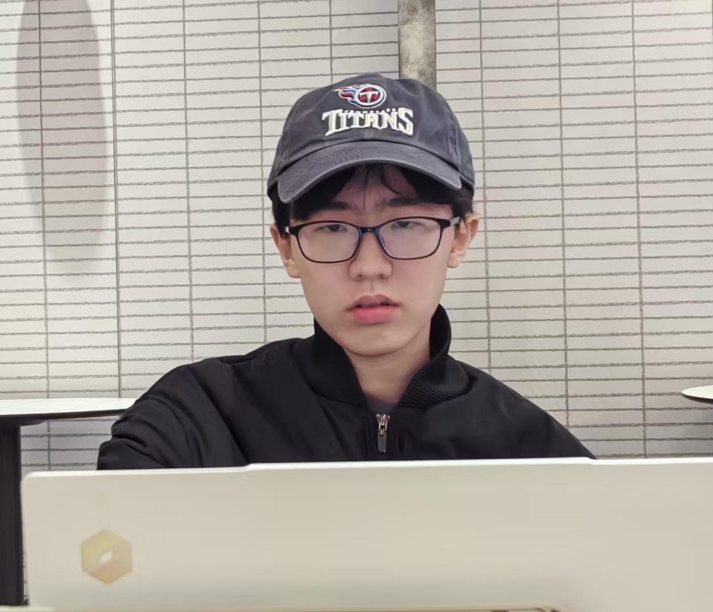

We are pleased to welcome three new students to the lab: **Xinao Ji**, **Yidi Sun**, and **Yiru Wang**. The students will continue their studies at Fudan University and join the group to pursue research in integrated circuits and related areas.

<!--more-->

The lab is always happy to welcome outstanding students with strong academic foundations, a passion for research, and a keen interest in biomedical integrated circuits, analog and mixed-signal circuits, and related topics. The arrival of these three new students will further strengthen the vitality and potential of the group in these research areas.

## Xinao Ji

**PhD Student (2026–)**

Xinao Ji received his B.Eng. degree in **Microelectronics Science and Engineering** from Xi’an Jiaotong University in **2023**. He then continued at Xi’an Jiaotong University as a recommended postgraduate student in **Electronic Science and Technology**, and is expected to receive his M.Eng. degree in **2026**. He will then join Fudan University to pursue a **PhD degree in Integrated Circuit Science and Engineering** in the group.

## Yidi Sun

**Master’s Student (2026–)**

Yidi Sun is currently an undergraduate student majoring in **Electronic Science and Technology** at Hunan University, and has been recommended for graduate study in **Electronic and Information Engineering** at Fudan University. Her future research will focus on topics such as **brain–computer interface circuits**. During her undergraduate study, she built a strong academic foundation and received several honors, including the **National Scholarship** and the **Second Prize in the National Finals of the China Integrated Circuit Innovation and Entrepreneurship Competition for College Students**.

## Yiru Wang

**Master’s Student (2026–)**

Yiru Wang is currently an undergraduate student majoring in **Microelectronics Science and Engineering** at Fudan University from **2023 to 2027**. During his undergraduate study, he systematically took core courses such as **Analog Integrated Circuits** and achieved excellent academic performance, building a solid foundation in microelectronics and integrated circuit design. He joined the group in **2026** for his undergraduate graduation project and plans to continue in the group for a **master’s degree in Integrated Circuit Science and Engineering** in **2027**.

The academic backgrounds of the three students span **electronic science and technology, microelectronics, electronic information, and analog/mixed-signal integrated circuit design**, which align closely with the lab’s current research directions, including:

- Biomedical integrated circuits and systems
- Analog and mixed-signal integrated circuits
- Sensor and neural interface circuits
- Data converters and analog front-end circuits
- Biomedical sensing interfaces and low-noise analog front-end circuits

Specifically, Xinao Ji will conduct research on analog and mixed-signal circuits, current conversion circuits, data converters, and analog front-end circuits. Yidi Sun will explore brain–computer interface circuits. Yiru Wang will focus on analog front-end circuit design and biomedical sensing interfaces.

Looking ahead, the lab will continue to pursue research on **high-performance, highly integrated chips and systems for biomedical and intelligent sensing applications**, and we look forward to growing together with more outstanding students in the years to come.
