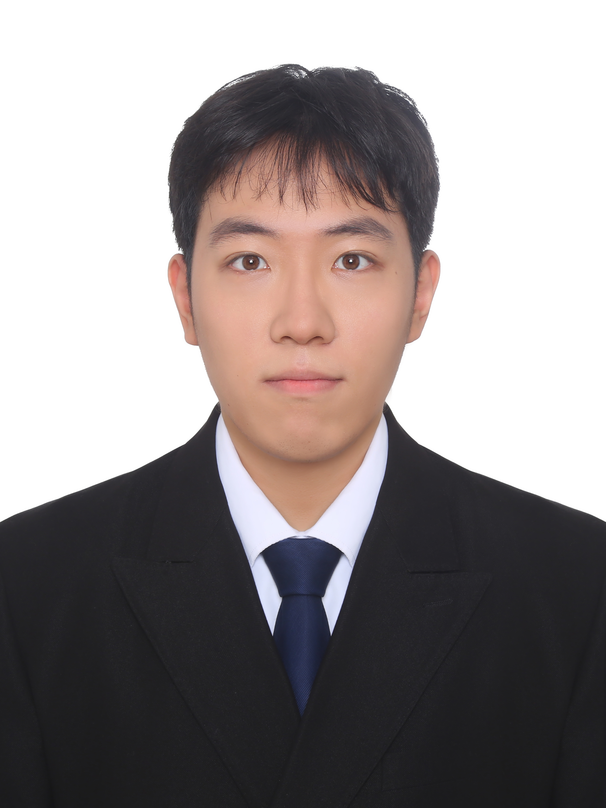
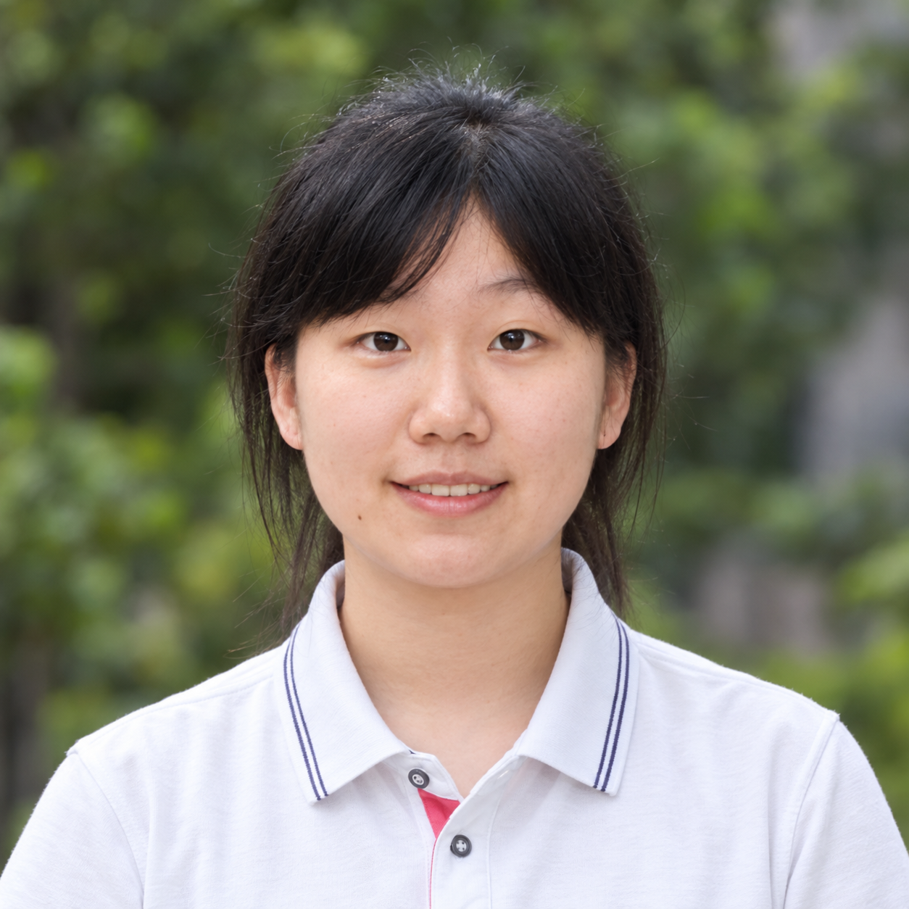
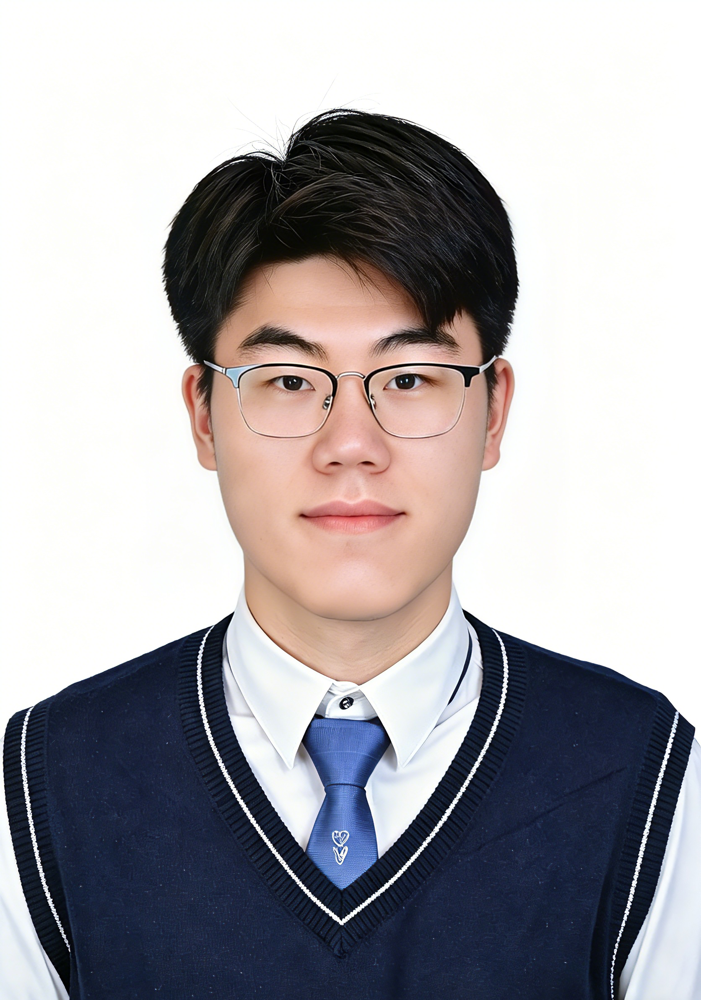
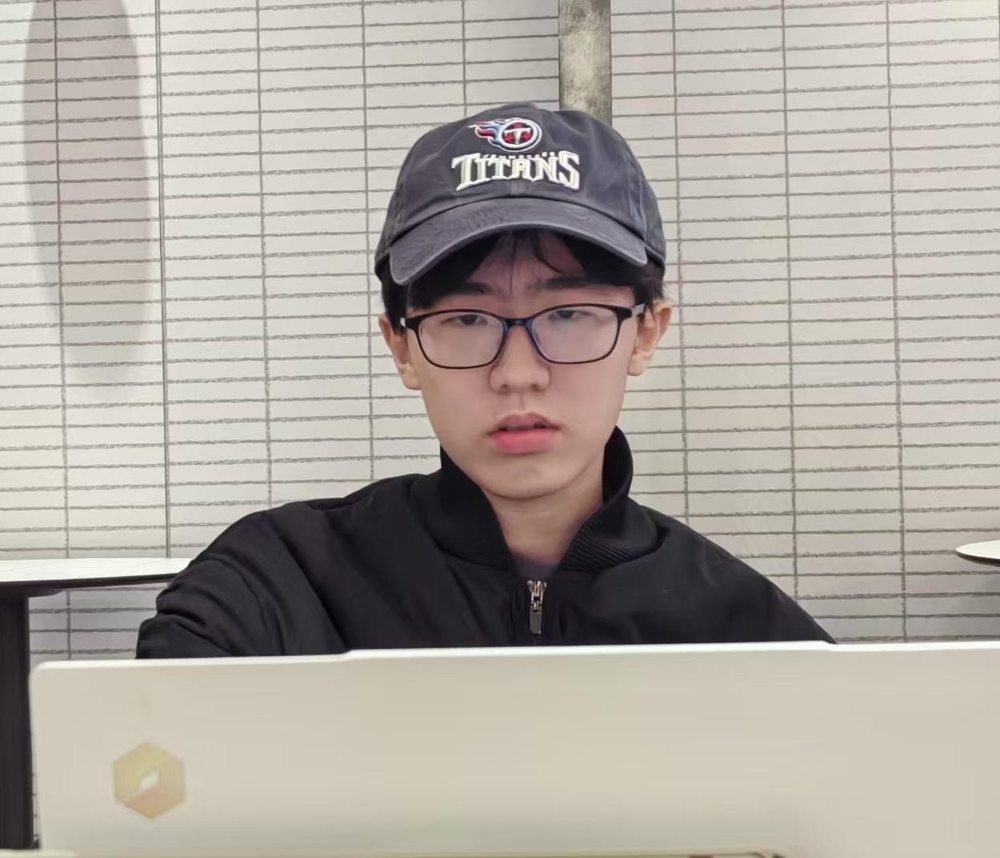
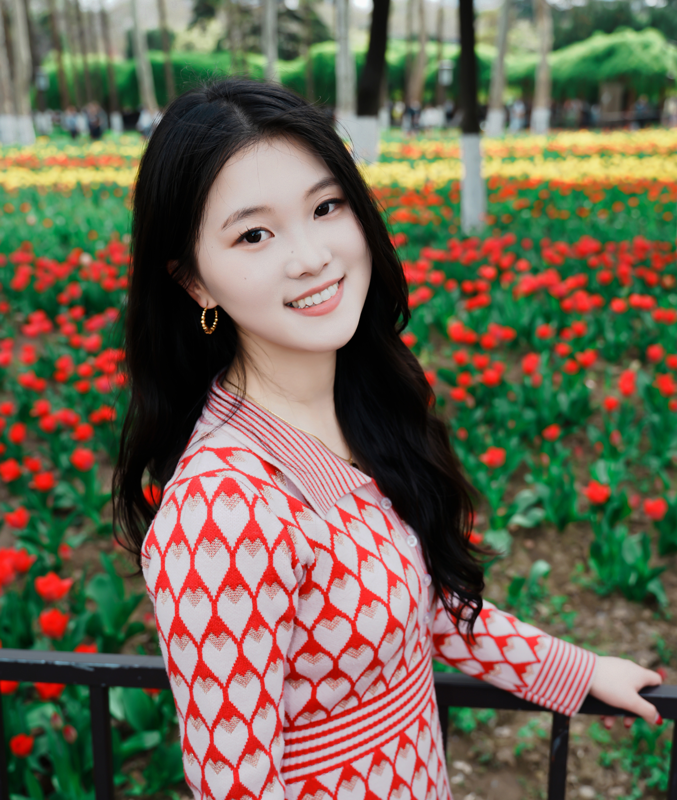
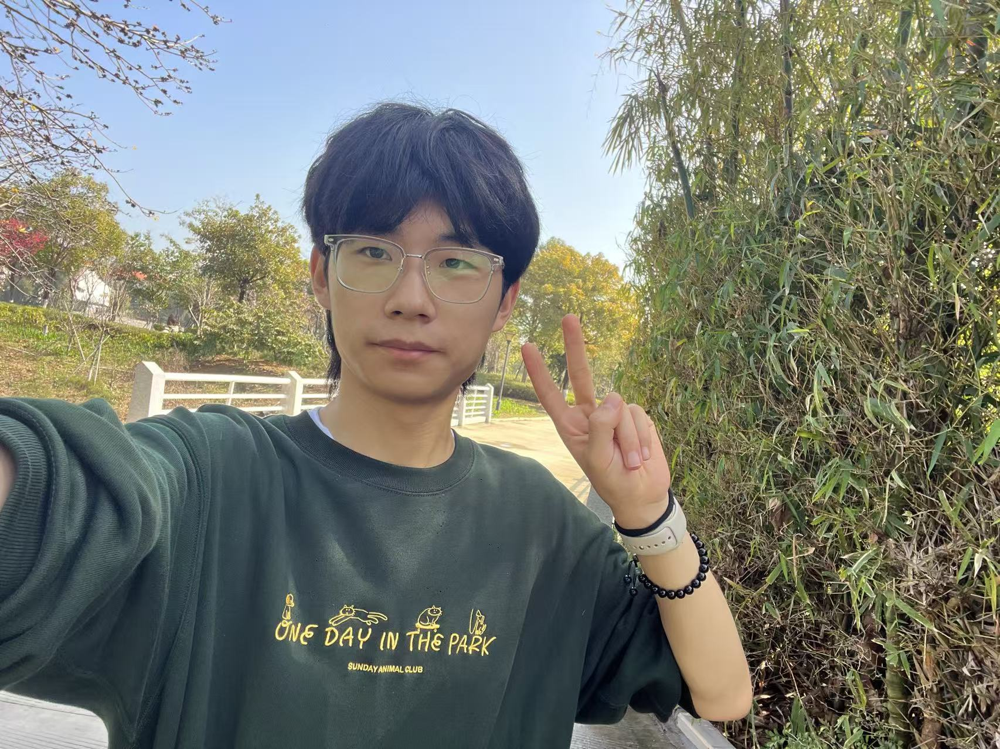

The laboratory is pleased to introduce **eight current and incoming students** in Qiuyang Lin’s group at Fudan University: **Xinao Ji, Ding Xu, Jiajie Lao, Yiru Wang, Siyi Yuan, Yidi Sun, Junyu Tang, and Zining Liu**. This announcement brings together students who joined the lab or began research activities in **2026**, alongside students preparing to begin graduate study in **2027**. Their individual timelines are described below; joining the group for research and formally enrolling in a graduate degree are distinct stages.

<!--more-->

The students bring backgrounds in electronic science and technology, microelectronics, and integrated circuit design. Their interests span biomedical integrated circuits, analog and mixed-signal circuits, neural interfaces, sensing front ends, power management, and data conversion.

## Doctoral Students

### Xinao Ji

**Ph.D. Student (2026–)**

Xinao Ji received his B.Eng. degree in **Microelectronics Science and Engineering** from Xi’an Jiaotong University in **2023**. During his undergraduate studies, he ranked among the top students in his major. He then continued at Xi’an Jiaotong University as a recommended postgraduate student in **Electronic Science and Technology** and received his M.Eng. degree in **2026**. He joined the group at Fudan University in the same year and is now pursuing a **Ph.D. degree in Integrated Circuit Science and Engineering**.

His research focuses on analog and mixed-signal circuits, current conversion circuits, analog-to-digital converters, and analog front-end circuits.

### Ding Xu

**Ph.D. Student (2027–)**

Ding Xu is currently an undergraduate student majoring in **Microelectronics Science and Engineering** at South China University of Technology. She has maintained an outstanding academic record, with a **GPA of 3.94/4.00**, and ranks **among the top students in her major**. Based on her excellent academic performance, she has been recommended for admission and will join the laboratory in **2027** to pursue a **Ph.D. degree in Integrated Circuit Science and Engineering**.

During her undergraduate studies, she worked on the circuit and layout design of low-dropout regulators and completed a full digital IC design flow project. Her research interests include analog and mixed-signal integrated circuits, LDOs, ADCs, and power management integrated circuits for biomedical applications.

### Jiajie Lao

**Ph.D. Student (2027–)**

Jiajie Lao is currently an undergraduate student majoring in **Integrated Circuit Design and Integrated Systems** at the School of Integrated Circuits, Nanjing University. He has consistently ranked among the top students in his major and has received several honors, including the **National Scholarship**, the university’s **Outstanding Communist Youth League Member Award**, and the **Outstanding Student Leader Award**. Based on his excellent academic performance, he has been recommended for admission and will join the laboratory in **2027** to pursue a Ph.D. degree.

He previously conducted a research internship in Prof. Huaqiang Wu’s group at Tsinghua University, where he participated in research on RRAM and computing-in-memory chips. He has also worked on hardware acceleration for the post-quantum Falcon signature algorithm and the design of a two-stage operational amplifier. His research interests include analog and mixed-signal integrated circuits, biomedical integrated circuits, analog front ends, and ADCs.

## Master’s Students

### Yiru Wang

**Master’s Student (2026–)**

Yiru Wang is currently an undergraduate student majoring in **Microelectronics Science and Engineering** at Fudan University from **2023 to 2027**. He ranks among the top students in his major. During his undergraduate study, he systematically took core courses such as **Analog Integrated Circuits** and achieved excellent academic performance, building a solid foundation in microelectronics and integrated circuit design.

He joined the group in **2026** for his **undergraduate graduation project** and plans to continue in the group for a **master’s degree in Integrated Circuit Science and Engineering** in **2027**. His research interests include analog front-end circuit design and biomedical sensing interfaces.

### Siyi Yuan

**Special-Program Master’s Student (2026–)**

Siyi Yuan received her B.Eng. degree from the **School of Integrated Circuits at Xidian University** in **2026**. During her undergraduate studies, she ranked among the top students in her major and developed a solid foundation in integrated circuit design. She received the **National Scholarship** and was recognized as an undergraduate **“Youth Role Model.”** She also gained practical experience through projects involving amplifiers and programmable gain amplifiers (PGAs).

In **2026**, Siyi joined Qiuyang Lin’s research group at the Institute for Frontier Technologies of Integrated Circuits and Systems, Fudan University, to pursue her master’s degree. As a **special-program master’s student jointly trained by Fudan University and Hua Hong**, her research interests include biomedical electronics, analog front-end integrated circuits, amplifiers, and programmable gain amplifiers. Through a specialized project conducted with Hua Hong, she will explore related integrated circuit technologies and continue developing her technical expertise through hands-on project experience.

Outside her studies and research, she enjoys hiking, swimming, and playing badminton. She also enjoys reading literature and books on cognition and ways of thinking.

### Yidi Sun

**Master’s Student (2026–)**

Yidi Sun studied **Electronic Science and Technology** at Hunan University and entered Fudan University through recommendation-based admission. She is now pursuing a master’s degree in **Electronic Information** in the group. During her undergraduate study, she ranked among the top students in her major, built a strong academic foundation, and received several honors, including the **National Scholarship** and the **Second Prize in the National Finals of the China Integrated Circuit Innovation and Entrepreneurship Competition for College Students**.

She joined the group in **2026**, and her research focuses on **brain–computer interface circuits**.

### Junyu Tang

**Master’s Student (2027–)**

Junyu Tang is currently an undergraduate student majoring in **Integrated Circuit Design and Integrated Systems** at the School of Integrated Circuits, Northwestern Polytechnical University. She has a **GPA of 4.018/4.1** and ranks **1st out of 115 students** in her major. She has received the **National Scholarship twice** and has been recommended for admission as the top-ranked student in her major. She will join the laboratory in **2027** to pursue a master’s degree.

During her undergraduate studies, she participated in the design of an analog front-end chip for optical sensors, working on a SAR ADC, sampling switches, a dynamic comparator, and a two-stage operational amplifier. Her research interests include analog and mixed-signal integrated circuits, analog front ends, data converters, and low-power operational amplifier design.

### Zining Liu

**Master’s Student (2027–)**

Zining Liu is currently an undergraduate student majoring in **Integrated Circuit Design and Integrated Systems** at Xiamen University, with a **GPA of 3.80/4.00**. He ranks **first in his major**, has been recommended for graduate admission, and will join the laboratory in **2027** to pursue a master’s degree.

During the undergraduate program, Zining conducted device modeling and simulation of emerging ferroelectric memories based on FeFETs and participated in the design of operational amplifiers and CTIA current-readout circuits at the Shanghai Institute of Technical Physics, Chinese Academy of Sciences. Zining’s research interests include analog integrated circuits, analog front-end and current-readout circuits, emerging ferroelectric memory modeling, and integrated circuit design and verification.

The laboratory welcomes all eight students and looks forward to their growth through study, research, and collaboration. Building on their experience in circuit design, biosignal acquisition, memory devices, and digital hardware, the group will continue to investigate high-performance, highly integrated chips and systems for biomedical and intelligent sensing applications. We hope that each student will develop sound technical foundations, remain curious, and contribute to meaningful research through careful work and shared learning.
