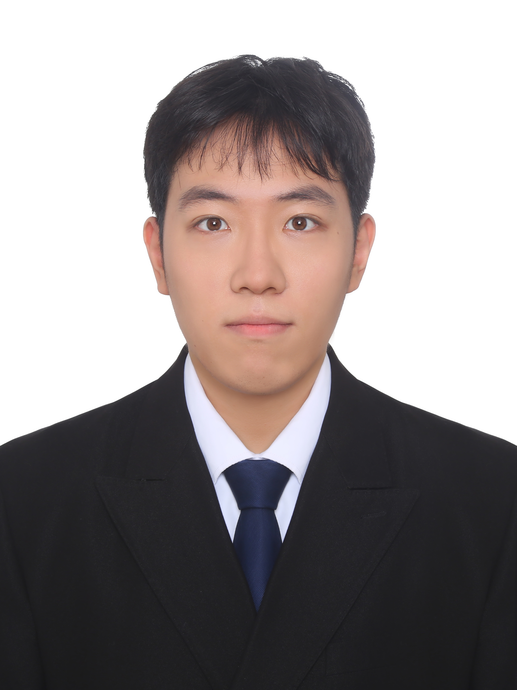
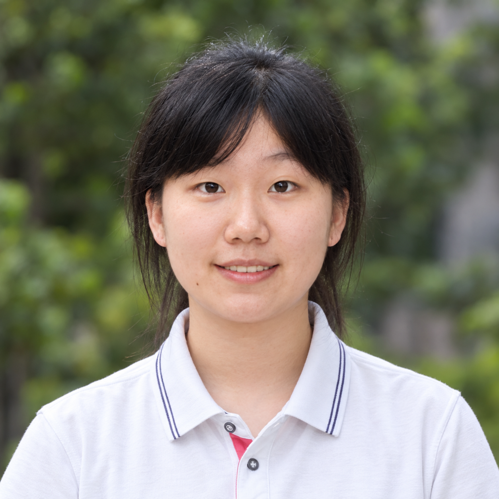
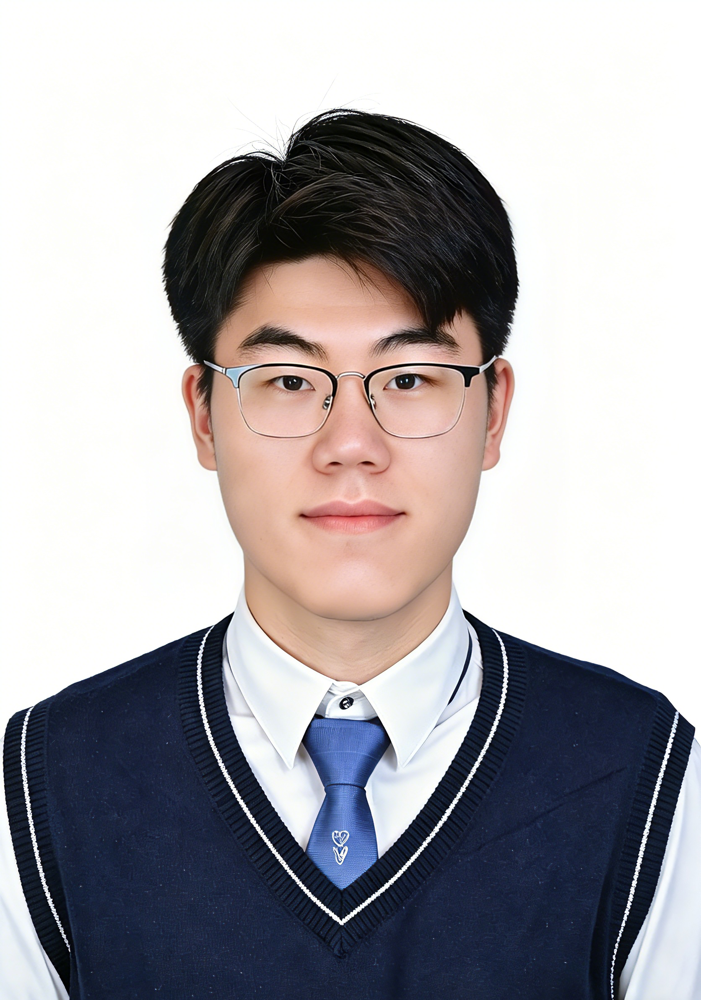
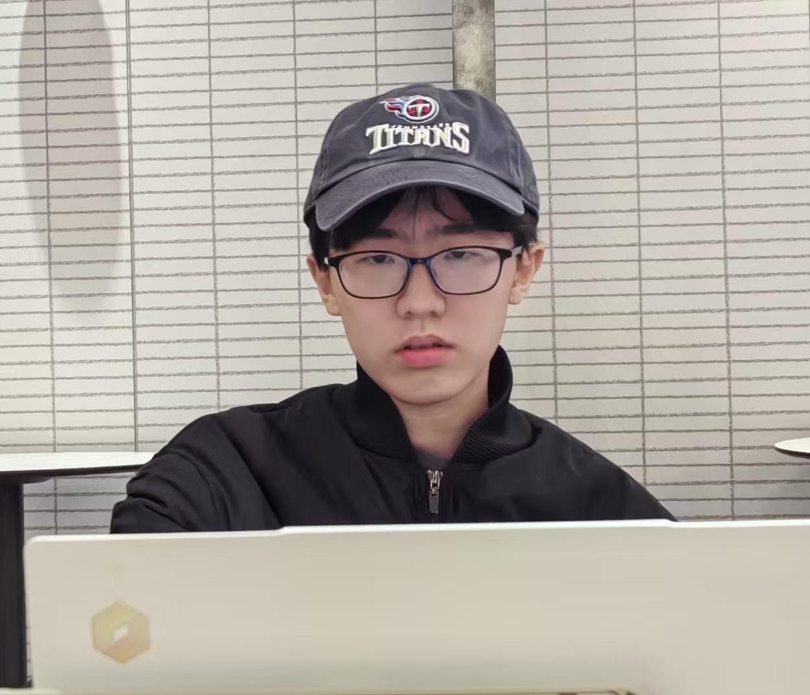
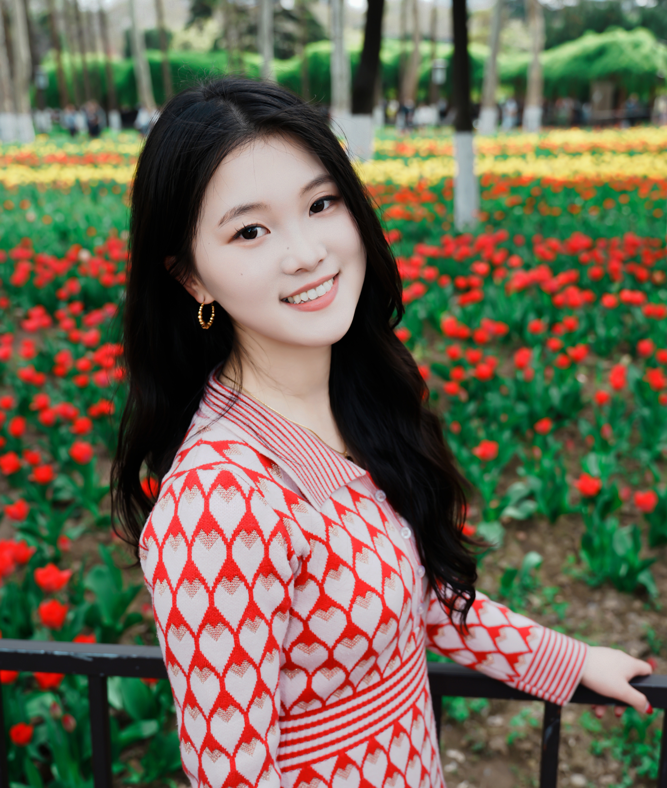
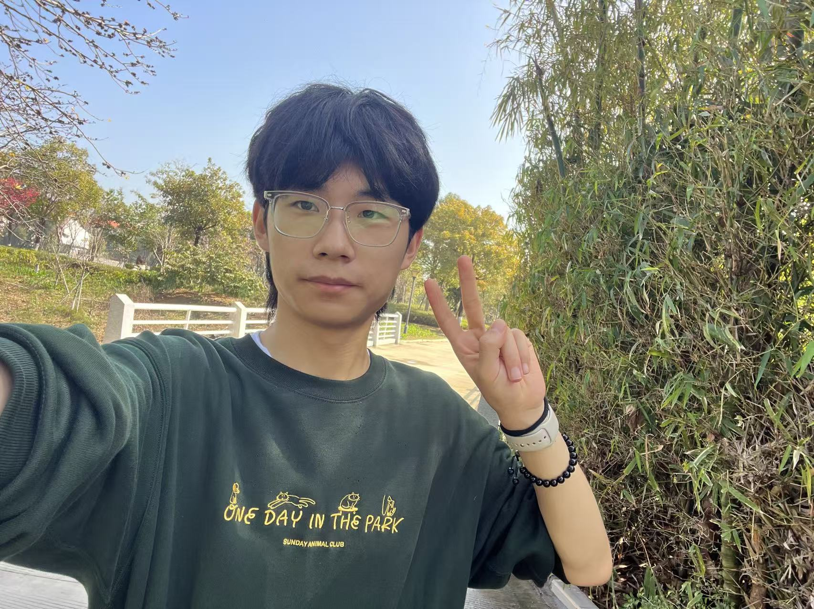

2026 年，实验室陆续迎来新同学加入、开展科研，并确定了下一阶段的研究生培养计划。**季心敖、徐鼎、劳嘉杰、王奕如、袁思怡、孙艺迪、汤珺玉和刘子宁**八位同学的研究兴趣涵盖生物医疗集成电路、模拟与混合信号电路、脑机接口及相关方向。

八位同学的学习阶段各不相同：部分同学于 2026 年进入课题组或开始学位学习，部分同学已获得推免资格、计划于 2027 年入学。其中，王奕如于 2026 年在课题组开展本科毕业设计，计划于 2027 年继续攻读硕士学位。以下按博士、硕士培养方向介绍各位同学。

<!--more-->

## 博士组

### 季心敖

**博士生（2026–）**

季心敖同学于 **2023 年**毕业于西安交通大学微电子科学与工程专业，获得工学学士学位。随后，他通过推免进入西安交通大学电子科学与技术专业攻读硕士学位，并于 **2026 年**获得工学硕士学位。

同年，他加入复旦大学，现于课题组攻读**集成电路科学与工程专业博士学位**，围绕模拟与混合信号电路、电流转换电路、模数转换器及模拟前端电路等方向开展研究。

### 徐鼎

**博士生（2027–）**

徐鼎同学本科就读于华南理工大学微电子科学与工程专业，GPA 为 3.94/4.00，专业成绩名列前茅。她凭借优异成绩获得推免资格，将于 2027 年进入复旦大学芯片与系统前沿技术研究院林秋阳老师课题组，攻读集成电路科学与工程专业博士学位。

本科期间，她围绕低压差线性稳压器开展电路与版图设计，并完成过数字 IC 全流程项目。她的研究兴趣包括模拟与混合信号集成电路、LDO、ADC，以及面向生物医疗应用的电源管理集成电路。

### 劳嘉杰

**博士生（2027–）**

劳嘉杰同学本科就读于南京大学集成电路学院集成电路设计与集成系统专业，专业成绩名列前茅，曾获国家奖学金、校优秀共青团员和校优秀学生干部等荣誉。他以优异成绩获得推免资格，将于 2027 年进入复旦大学芯片与系统前沿技术研究院林秋阳老师课题组攻读博士学位。

本科期间，他曾在清华大学集成电路学院吴华强老师课题组参与 RRAM 与存算一体芯片研究，并开展 Falcon 后量子签名算法硬件加速和两级运算放大器设计。他的研究兴趣包括模拟与混合信号集成电路、生物医疗集成电路、模拟前端和 ADC。

## 硕士组

### 王奕如

**硕士生（2026–）**

王奕如同学本科就读于复旦大学微电子科学与工程专业（2023–2027）。在本科阶段，他系统修读了《模拟集成电路》等专业课程并取得优异成绩，具备扎实的微电子与集成电路专业基础。

他于 **2026 年**加入课题组开展本科毕业设计，计划于 **2027 年**继续在本课题组攻读**集成电路科学与工程专业硕士学位**，重点关注模拟前端电路与生物医疗传感接口等方向。

### 袁思怡

**专项硕士生（2026–）**

袁思怡同学于 **2026 年**在西安电子科技大学集成电路学部获得工学学士学位。本科期间，她专业成绩名列前茅，专业基础扎实，曾获**国家奖学金**、本科生 **“青春人物”** 等荣誉，并参与过放大器、可编程增益放大器（PGA）等项目，积累了模拟集成电路设计方面的实践经验。

2026 年，袁思怡同学进入复旦大学芯片与系统前沿技术研究院林秋阳老师课题组攻读硕士学位。她是由**复旦大学与华虹公司联合培养的专项硕士研究生**，研究兴趣包括生物医疗电子、模拟前端集成电路以及放大器与可编程增益放大器设计。

学习与科研之余，她喜欢户外徒步、游泳和羽毛球，也喜爱阅读文学作品以及认知与思维类书籍。未来，她将结合与华虹公司开展的专项项目，围绕相关集成电路技术进行学习与研究，在项目实践中不断提升专业能力。

### 孙艺迪

**硕士生（2026–）**

孙艺迪同学本科就读于湖南大学电子科学与技术专业，通过推免进入复旦大学电子信息专业，现于课题组攻读硕士学位。在本科阶段，她打下了良好的专业基础，曾获**国家奖学金**、**全国大学生集成电路创新创业大赛全国总决赛二等奖**等荣誉。

她于 **2026 年**加入课题组，围绕**脑机接口电路**等方向开展研究。

### 汤珺玉

**硕士生（2027–）**

汤珺玉同学本科就读于西北工业大学集成电路学院集成电路设计与集成系统专业，GPA 为 4.018/4.1，专业排名 1/115。她曾两次获得国家奖学金，并以专业第一名的优异成绩获得推免资格，将于 2027 年进入复旦大学芯片与系统前沿技术研究院林秋阳老师课题组攻读硕士学位。

本科期间，她参与了光电传感器模拟前端芯片设计，完成 SAR ADC、采样开关、动态比较器及两级运算放大器等电路的设计与仿真。她的研究兴趣包括模拟与混合信号集成电路、模拟前端、数据转换器和低功耗运算放大器。

### 刘子宁

**硕士生（2027–）**

刘子宁同学本科就读于厦门大学集成电路设计与集成系统专业，GPA 为 3.80/4.00，专业排名第一，已获得推免资格，将于 2027 年进入复旦大学芯片与系统前沿技术研究院林秋阳老师课题组攻读硕士学位。

本科期间，刘子宁同学开展了 FeFET 器件建模与仿真研究，并曾在中国科学院上海技术物理研究所参与运算放大器和 CTIA 电流读出电路设计。研究兴趣包括模拟集成电路、模拟前端与电流读出电路、新型铁电存储器建模及集成电路设计与验证。

## 共同成长

八位同学的学习与研究经历涵盖模拟与混合信号电路、神经与传感接口、数据转换器、电源管理、新型存储器及数字硬件设计等方向。实验室将继续围绕面向生物医疗与智能感知应用的芯片与系统开展研究，为同学们提供从基础学习、电路设计到系统验证的实践机会。欢迎大家加入课题组，期待在日常学习与合作中相互启发、踏实探索，共同做出有意义的研究工作。
