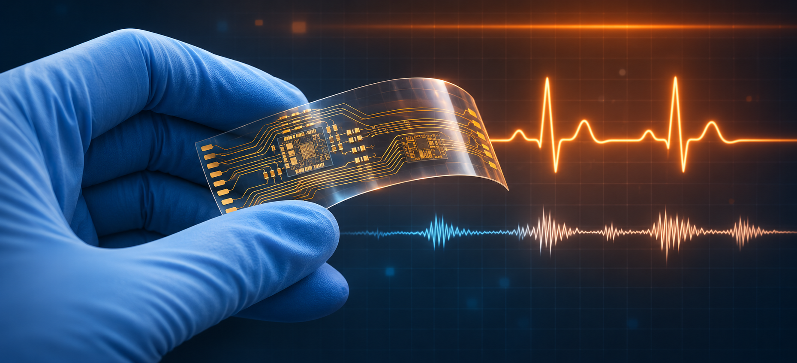
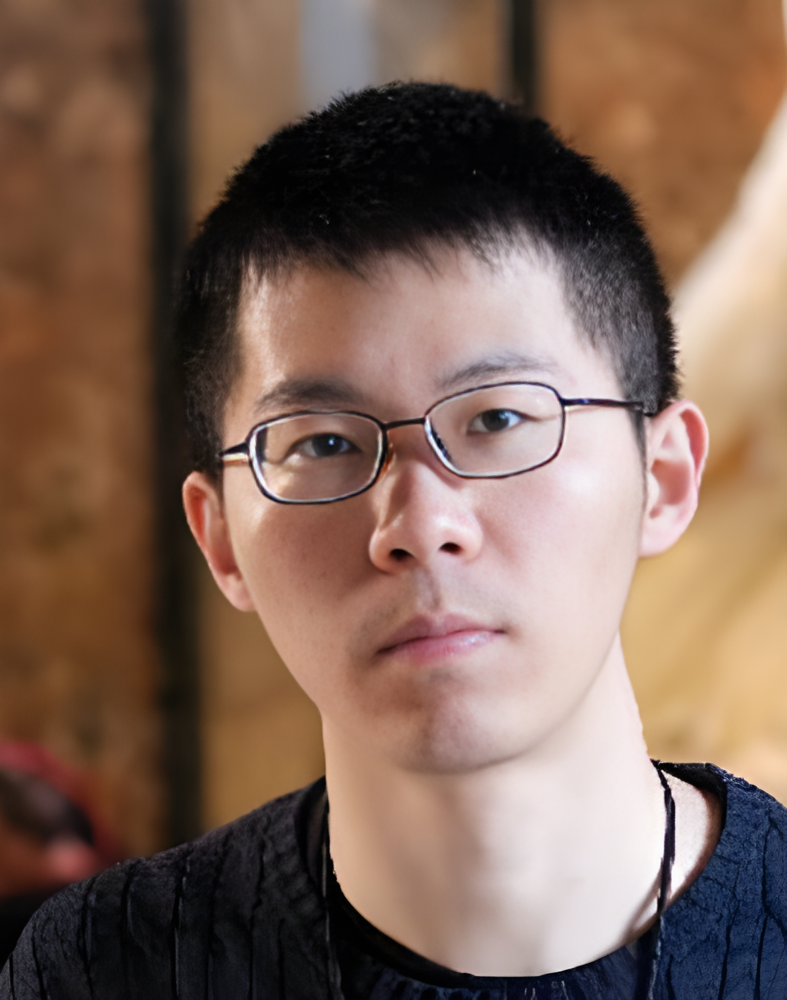

A paper on a **flexible biosignal readout IC**, with **Chen Wang of imec and KU Leuven** as first author and **Qiuyang Lin** among the co-authors, has been accepted at the **2027 IEEE International Solid-State Circuits Conference (ISSCC 2027)**. It is scheduled for presentation as **Paper 12.9**.

<!--more-->

[ISSCC](https://www.isscc.org/) is a leading international conference on solid-state circuits and systems-on-chip, bringing together advances from academia and industry. **ISSCC 2027 will take place in San Francisco on February 14–18, 2027**, under the theme **“Trusted Sustainable Silicon Intelligence from Edge to Cloud.”**

## A flexible analog front-end for ECG and EMG

The paper is entitled **“A 0.6μm N-Type-Only IGZO ECG/EMG Readout FlexIC Integrating a 44.7dB CCIA and a 9.24b ENOB 140kS/s Power-Gated Asynchronous SAR ADC.”**

The work targets **electrocardiogram (ECG) and electromyogram (EMG) acquisition**. Using **0.6 μm n-type-only IGZO technology**, it integrates signal amplification and analog-to-digital conversion in a **flexible analog front-end (AFE)**. Such circuits are relevant to the development of thin, conformable biosignal monitoring systems for wearable and healthcare applications.

The published paper title highlights the integration of:

- A **44.7 dB capacitively coupled instrumentation amplifier (CCIA)**;
- An **ADC with 9.24-bit effective number of bits (ENOB) at 140 kS/s**;
- A **power-gated asynchronous SAR ADC architecture**.

At the heart of the work is the integration of biosignal amplification and digitization on a flexible platform. It brings together device characteristics, circuit architecture and the practical requirements of physiological signal acquisition.

## Chen Wang's contribution

Now in the **second year of his PhD research at imec and KU Leuven**, Chen has already published first-author papers in [**IEEE TCAS-II**](https://doi.org/10.1109/TCSII.2025.3576073), [**IEEE OJCAS**](https://doi.org/10.1109/OJCAS.2025.3631308), [**IEEE ISCAS**](https://doi.org/10.1109/ISCAS56072.2025.11043689) and [**ESSERC**](https://doi.org/10.1109/ESSERC66193.2025.11213979). These studies span high-resolution noise-shaping SAR ADCs, flexible LTPS device modeling and robust analog circuit design, establishing a strong foundation for his ongoing work in flexible electronics.

For this ISSCC paper, Chen made a substantial contribution through extensive **flexible-chip characterization, measurement analysis, and AFE design and validation**. His sustained experimental effort connected measured device behavior with circuit design decisions, providing an important foundation for the integrated flexible readout IC.

**Chen's persistence and hands-on work were central to advancing the project.** Working closely with his collaborators, he helped bring together device characteristics, process capabilities, circuit design and testing to realize the flexible ECG/EMG AFE. The result reflects both his individual contribution and the complementary expertise of the author team.

## Presentation at ISSCC 2027

The current [Advance Program](https://submissions.mirasmart.com/ISSCC2027/PDF/ISSCC2027AdvanceProgram.pdf#page=41) lists the presentation as follows:

- **Paper: 12.9**
- **Session 12: Wearable and Portable Biosensing**
- **Time: Tuesday, February 16, 2027, at 11:20 AM Pacific Standard Time (San Francisco local time)**
- **Venue: San Francisco Marriott Marquis, San Francisco, USA**

**Conference attendees interested in flexible electronics, biosignal readout and biomedical integrated circuits are welcome to attend Chen Wang's presentation and discuss the work with the authors.**

Please check the [latest ISSCC program](https://www.isscc.org/program-overview) for any schedule updates.
