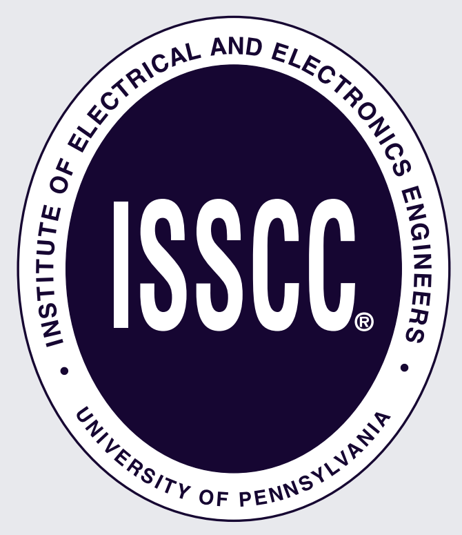
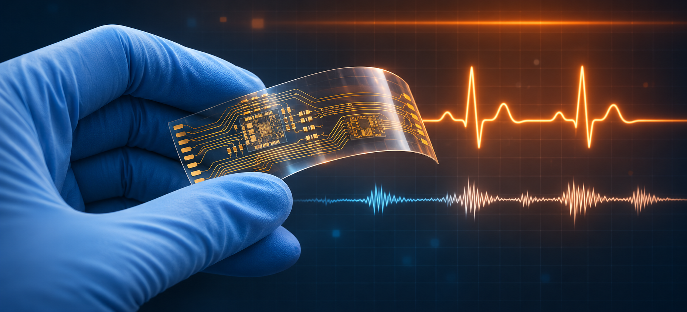

近日，由**王辰同学担任第一作者**的**柔性生理信号读出芯片**论文获 **2027 IEEE 国际固态电路会议（ISSCC 2027）** 接收，将作为 **12.9** 报告在大会上交流。这一成果是实验室在柔性生物医疗集成电路方向取得的新进展。林秋阳为该论文的通讯作者。

<!--more-->

[ISSCC](https://www.isscc.org/) 是固态电路与片上系统领域的重要国际学术会议，汇集来自学术界与产业界的前沿芯片研究。**ISSCC 2027 将于 2027 年 2 月 14–18 日在美国旧金山举行**，本届主题为“Trusted Sustainable Silicon Intelligence from Edge to Cloud”，即“从边缘到云端的可信、可持续硅基智能”。

## 面向心电与肌电监测的柔性模拟前端

论文题为 **“A 0.6μm N-Type-Only IGZO ECG/EMG Readout FlexIC Integrating a 44.7dB CCIA and a 9.24b ENOB 140kS/s Power-Gated Asynchronous SAR ADC”**。

该工作面向**心电（ECG）与肌电（EMG）信号采集**，采用 **0.6 μm、仅 N 型 IGZO** 技术，在柔性集成电路中整合信号放大与模数转换功能，探索高集成度、高性能的**柔性模拟前端（AFE）**。这类电路为更轻薄、可贴合的生理信号监测系统提供了新的实现路径，也让生物医疗电子有机会更自然地融入日常佩戴与健康监测场景。

根据大会公布的论文题目，该芯片集成了：

- **44.7 dB 电容耦合仪表放大器（CCIA）**；
- **有效位数（ENOB）为 9.24 bit、采样率为 140 kS/s 的模数转换器**；
- **采用电源门控的异步 SAR ADC 架构**。

将生理信号放大与数字化读出集成于柔性平台，是这项工作的核心。它不仅关注单个电路模块的实现，也着眼于柔性器件、电路架构与生物信号采集需求之间的结合。

## 王辰：从扎实积累到 ISSCC

王辰于 **2020 年**获得电子科技大学集成电路设计与集成系统专业学士学位，于 **2024 年**获得苏黎世联邦理工学院（ETH Zurich）电气工程与信息技术硕士学位。2023 年，他在林秋阳指导下于 imec 开展科研实习与毕业设计。目前，他在 **imec 与鲁汶大学（KU Leuven）攻读博士学位，现为博士二年级学生**，主要研究柔性薄膜晶体管电路、模拟前端与模数转换器。

博士学习进入第二年，王辰已以第一作者在 [**IEEE TCAS-II**](https://doi.org/10.1109/TCSII.2025.3576073)、[**IEEE OJCAS**](https://doi.org/10.1109/OJCAS.2025.3631308)、[**IEEE ISCAS**](https://doi.org/10.1109/ISCAS56072.2025.11043689) 和 [**ESSERC**](https://doi.org/10.1109/ESSERC66193.2025.11213979) 等国际期刊与会议发表多篇高水平论文，研究涵盖高精度噪声整形 SAR ADC、柔性 LTPS 器件建模与稳健模拟电路设计。能够在博士阶段早期持续产出扎实成果，并进一步在 ISSCC 展示新的研究进展，体现了他出色的研究潜力，更离不开长期勤奋的投入和对实验细节的认真。

为完成本次 ISSCC 工作，王辰开展了大量**柔性芯片特性表征（characterization）与测试分析**，深入理解器件和电路的实际表现，并将这些认识融入模拟前端的设计与验证。他持续往返于测量、分析和电路设计之间，把实验中发现的问题落实为设计中的改进，为这一**高集成度、高性能柔性 AFE** 的实现打下了坚实基础。

**在王辰的持续努力与积极推进下**，合作团队将器件、工艺、电路设计和测试验证等环节紧密衔接，共同完成了这项研究。实验室向王辰及全体合作者表示祝贺，并感谢团队各方的支持与协作。我们期待王辰继续保持这份专注与热情，在柔性电子和生物医疗集成电路领域做出更多有意义、经得起验证的成果。

## 报告预告：明年旧金山见

根据目前公布的[大会预告议程](https://submissions.mirasmart.com/ISSCC2027/PDF/ISSCC2027AdvanceProgram.pdf#page=41)，报告安排如下：

- **论文编号：12.9**
- **专题：Session 12 — Wearable and Portable Biosensing（可穿戴与便携式生物传感）**
- **时间：2027 年 2 月 16 日（星期二）上午 11:20，旧金山当地时间（PST）**
- **地点：San Francisco Marriott Marquis，美国旧金山**

**欢迎各位同行、朋友和同学明年前往 ISSCC 2027 听取王辰的报告，与我们交流柔性电子、生理信号读出及生物医疗集成电路的研究进展。期待在旧金山相见！**

具体安排请以 [ISSCC 最新议程](https://www.isscc.org/program-overview)为准。
